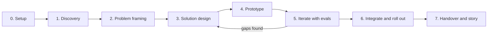

# FirstShift

**From staffing gap to first productive shift: an AI agent deployment for a fast-food chain.**

FirstShift is a Forward Deployed Engineering (FDE) case study built end to end: discovery inside a (fictional) quick-service restaurant group, problem framing, divergent solution design, rapid prototyping, evaluation-driven iteration and integration into the client's real workflows (ATS, HRIS, scheduling, WhatsApp, manager routines).

> All client data, names, systems and numbers in this repository are fictional and exist only to simulate a realistic deployment. Any resemblance to a real company is not intended.

---

## The one-line thesis

Fast-food hiring is not a screening problem. It is a **time-to-first-productive-shift** problem. Recruiting, onboarding and scheduling are owned by three different teams and three different systems, and the candidate falls through the gaps between them. FirstShift treats the first worked shift as the conversion event and orchestrates everything upstream of it.

## Why this project exists

The FDE role is about sitting with a client, understanding how work really happens, finding the leverage point nobody asked about, and shipping something that lives inside their workflows (not next to them). This repo documents every phase of that loop, with the evidence, so a reviewer can audit decisions, not just code.

## Results (simulated pilot, day 30)

Every number in this section is a **simulation outcome** produced by this repository's pipeline, eval harness and pilot simulator; nothing is a real-world effect. Sources: `docs/pilot-sim-day30.md`, `evals/reports/eval-v5.md`, `evals/reports/redteam-v1.md`, `docs/iteration-log.md`.

- In the simulated day-30 pilot (seed 42), 726 pilot applications ran through the real pipeline against a statistical control arm: the simulated contact rate was 100% versus 58% in the control model, the median simulated application-to-first-shift proxy was 6.3 days versus 26.4 in the control, and 497 first shifts were worked.
- In the same simulation, 156 simulated hires were scheduled and still did not show up on day 1, and 72 manager decision SLA breaches fired, which turned into concrete client decisions before any real candidate would be contacted.
- Across the eval suite (44 synthetic personas), the simulated runs kept task success at 44 of 44 with 0 deterministic guardrail failures, and four measured iterations took four defects to 0 (identifier leaks, language drift, duplicate consent asks, multi-question messages).
- The red-team suite ended 7 of 7 adversarial classes in the designed safe behavior, including prompt injection and an offer-without-approval attempt.
- The control arm is a statistical model of the as-is funnel, not a run of real code; the candidate and manager sides are synthetic. Full caveats: `docs/pilot-sim-day30.md`.

## What is stubbed

The exists/stubbed/simulated table with evidence for every row is in `docs/handover.md`. The honest short version: the Twilio adapter is real code but WhatsApp template registration is a client setup step; all client systems are mocks; alerts are documented queries with no pager wired; the GDPR erasure tombstone and the first-shift day-before confirmation template are designed but not implemented; the eval judge is a deterministic stand-in plus one live-judge calibration that showed 17% exact agreement with human labels; there is no day-90 pilot report. The note under "Console UI status (F05)" below predates the console API feature; the current route-by-route status is the handover table.

## Documentation

| Doc | What it is |
|---|---|
| `docs/handover.md` | Handover pack: exists/stubbed/simulated table, run-test-evaluate-deploy in 10 commands, architecture, ranked risks, next features, ownership |
| `docs/case-study.md` | The FDE case study: discovery, reframe, build, simulated results, next steps with a real client |
| `docs/demo-video-notes.md` | Shot list for the 2-minute demo (D1, D4, D6) with voice-over and captions |
| `docs/interview-narrative.md` | 30-second and 2-minute versions, Q&A, bridge placeholder |
| `docs/integration-guide.md` | Ports, per-system contracts and the WhatsApp channel |
| `docs/reliability.md` | Alerts, SLOs, degraded mode, and what is documented but not wired |
| `docs/iteration-log.md` | The measured keep/revert log, one change per iteration |
| `docs/pilot-sim-day30.md` | Simulated pilot day-30 ops review with caveats |

The console runs at http://localhost:5173 (Overview, Live, Candidates, Restaurants, Ops, Evals, Compliance, Simulator); the API docs at http://localhost:8001/docs.

---

## Repository map

| Path | What it is | Used by |
|---|---|---|
| `AGENTS.md` | Operating contract for the coding agents (stack, rules, TDD, ODD conventions) | Every agent session |
| `specs/00-client-brief.md` | Fictional client dossier: Lumbre Burger Group | Discovery |
| `specs/01-discovery.md` | Stakeholders, simulated interviews, as-is process, systems and data | Phase 1 |
| `specs/02-problem-framing.md` | Problem statements, hypotheses, metric tree, constraints, non-goals | Phase 2 |
| `specs/03-solution-design.md` | Divergent options, chosen concept, agents, state machine, architecture | Phase 3 |
| `specs/04-prototype.md` | Walking skeleton and prototype v1 scope, mocks, simulator, demo script | Phase 4 |
| `specs/04b-console.md` | FirstShift Console (React + Tailwind + Vite): live agent activity, candidate journeys, takeover, metrics, simulator | Phase 4 to 6 |
| `specs/05-iteration-evals.md` | Eval harness, synthetic personas, iteration protocol, fairness checks | Phase 5 |
| `specs/06-integration-rollout.md` | Adapters, reliability, security, pilot, rollout waves, runbook | Phase 6 |
| `specs/07-handover-and-story.md` | Handover pack, case study, demo video, interview narrative | Phase 7 |
| `PROMPTS.md` | Ordered prompts to run each phase with gentle-shell (Pi) under ODD | You |
| `odd/tasks/` | Feature documents created by the agents during ODD (do not pre-fill) | Agents |
| `discovery/`, `design/`, `evals/`, `docs/` | Phase outputs written by the agents | Agents |
| `app/`, `mocks/`, `simulator/`, `tests/` | Backend code (Python) | Agents |
| `web/` | FirstShift Console (React + TypeScript + Tailwind on Vite) | Agents |

## Two halves, one system

| Half | Tech | Who uses it |
|---|---|---|
| **Agent backend** | Python, FastAPI, Postgres, Celery, Strands Agents on the OpenAI API, Langfuse, Grafana, Sentry | Candidates and managers, through WhatsApp only |
| **FirstShift Console** | React, TypeScript, Tailwind, Vite | HQ Talent team, DPO, Ops leadership, and the demo |

The console shows every candidate journey, every agent turn and tool call, every write to a client system and every metric, live, and lets a human pause the agents or take over any conversation. Managers never need it: that is a deliberate design constraint from discovery.

### Console UI status (F05)

The three views from the mockups in `web/public/img` are implemented with mocked data while the backend is built in parallel (feature document: `odd/tasks/console-ui.md`):

- `/` Overview: KPI cards with baseline, target and sparkline, pilot vs control funnel, needs attention strip, recent activity and the 14 day shift coverage table.
- `/live` Live agent activity: event feed with kind filters, pause and resume, expandable tool call rows (prompt version, model, tokens, schema validation, trace, tool JSON), health and guardrails panels.
- `/candidates/C-0214` Candidate journey: timeline, candidate and manager threads with inline tool call chips, matched shift and record rail, take over and release flow.

Data is served by `web/src/api/client.ts` from fixtures in `web/src/mocks/`; components never import fixtures. When the FastAPI schema is live, swap the client bodies for real fetches and replace the hand written types in `web/src/api/types.ts` with `pnpm gen:api` output.

## Phase map



Each phase is one or more **ODD features**. The agent explores, resolves only real uncertainty, classifies the work, creates `odd/tasks/<feature>.md` for substantial work, implements task by task (test-first where a test applies) and closes with verified evidence. The specs in `specs/` are the source of truth: prompts point to them by path so exact wording reaches the workers intact.

## Working schedule (interview on Tue 27 Oct, 16:00 CET)

| Day | Focus | Exit criterion |
|---|---|---|
| Mon 19 | Setup + Phase 1 discovery | `discovery/` complete, as-is map reviewed by Albert |
| Tue 20 | Phase 2 framing + Phase 3 design | Concept chosen with scoring matrix, architecture diagram |
| Wed 21 | Phase 4 walking skeleton + console shell | One candidate flows from webhook to scheduled first shift on mocks; console shell streams live events |
| Thu 22 | Phase 4 prototype v1 + console simulator and live feed | Demo script runs end to end from the console simulator |
| Fri 23 | Console candidate journey and overview + Phase 5 evals | Journey view with takeover works; eval report v1 with baseline numbers |
| Sat 24 | Phase 5 iteration 2 + Phase 6 adapters | Iteration log shows a measured improvement; adapters behind ports |
| Sun 25 | Phase 6 pilot simulation + runbook | Pilot report for 3 simulated restaurants |
| Mon 26 | Phase 7 case study, 2-min video, English narrative | Story rehearsed twice out loud |

Priority if time runs short: a working end-to-end demo with one evaluated iteration beats a wide but shallow build. Phase 6 can stay at "designed + one real adapter + mocks" for the 27th and deepen afterwards for technical rounds.

## Git workflow and CI

- `dev` is the integration branch; all `feature/...` and `fix/...` branches come from it and merge back through pull requests.
- `main` only receives demo-ready merges from `dev`.
- CI on every push and PR (`.github/workflows/ci.yml`): backend pytest + ruff + mypy, console vitest + ESLint + tsc + Vite build, and compose config validation. Secret scanning is owned by GitGuardian; secrets never live in the repository (see `env.example`, `.env` is gitignored).
- Dependabot keeps npm, uv and GitHub Actions dependencies current.

## Quick start

Everything runs in Docker: both halves plus Langfuse (LLM observability), Grafana + Prometheus (metrics) and the Sentry SDK hook (error tracking via DSN).

```bash
cp env.example .env                 # fill in OPENAI_API_KEY and the rest
docker compose up -d --build       # full stack
```

| URL | What |
|---|---|
| http://localhost:5173 | FirstShift Console (shell, Overview, Live activity and Candidate journey with mocked data in F05) |
| http://localhost:8001/docs | API (OpenAPI; the container serves 8000, host port 8001) |
| http://localhost:3000 | Langfuse |
| http://localhost:3001 | Grafana (admin / GRAFANA_ADMIN_PASSWORD) |
| http://localhost:9090 | Prometheus |

Run tests and checks locally (faster than inside Docker):

```bash
# Backend (Python 3.12, uv)
uv sync
docker compose up -d postgres redis    # only what tests need, when DB tests exist
uv run pytest
uv run ruff check .
uv run mypy app

# Console (web/, pnpm)
cd web
pnpm install
pnpm test
cd ..

make up            # alternative to docker compose up -d --build
make down          # stop
```
