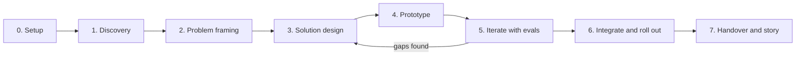

# FirstShift

**From staffing gap to first productive shift: an AI agent deployment for a fast-food chain.**

FirstShift is a Forward Deployed Engineering (FDE) case study built end to end: discovery inside a (fictional) quick-service restaurant group, problem framing, divergent solution design, rapid prototyping, evaluation-driven iteration and integration into the client's real workflows (ATS, HRIS, scheduling, WhatsApp, manager routines).

> All client data, names, systems and numbers in this repository are fictional and exist only to simulate a realistic deployment. Any resemblance to a real company is not intended.

---

## The one-line thesis

Fast-food hiring is not a screening problem. It is a **time-to-first-productive-shift** problem. Recruiting, onboarding and scheduling are owned by three different teams and three different systems, and the candidate falls through the gaps between them. FirstShift treats the first worked shift as the conversion event and orchestrates everything upstream of it.

## Why this project exists

The FDE role is about sitting with a client, understanding how work really happens, finding the leverage point nobody asked about, and shipping something that lives inside their workflows (not next to them). This repo documents every phase of that loop, with the evidence, so a reviewer can audit decisions, not just code.

---

## Repository map

| Path | What it is | Used by |
|---|---|---|
| `AGENTS.md` | Operating contract for the coding agents (stack, rules, TDD, ODD conventions) | Every agent session |
| `specs/00-client-brief.md` | Fictional client dossier: Lumbre Burger Group | Discovery |
| `specs/01-discovery.md` | Stakeholders, simulated interviews, as-is process, systems and data | Phase 1 |
| `specs/02-problem-framing.md` | Problem statements, hypotheses, metric tree, constraints, non-goals | Phase 2 |
| `specs/03-solution-design.md` | Divergent options, chosen concept, agents, state machine, architecture | Phase 3 |
| `specs/04-prototype.md` | Walking skeleton and prototype v1 scope, mocks, simulator, demo script | Phase 4 |
| `specs/04b-console.md` | FirstShift Console (React + Tailwind + Vite): live agent activity, candidate journeys, takeover, metrics, simulator | Phase 4 to 6 |
| `specs/05-iteration-evals.md` | Eval harness, synthetic personas, iteration protocol, fairness checks | Phase 5 |
| `specs/06-integration-rollout.md` | Adapters, reliability, security, pilot, rollout waves, runbook | Phase 6 |
| `specs/07-handover-and-story.md` | Handover pack, case study, demo video, interview narrative | Phase 7 |
| `PROMPTS.md` | Ordered prompts to run each phase with gentle-shell (Pi) under ODD | You |
| `odd/tasks/` | Feature documents created by the agents during ODD (do not pre-fill) | Agents |
| `discovery/`, `design/`, `evals/`, `docs/` | Phase outputs written by the agents | Agents |
| `app/`, `mocks/`, `simulator/`, `tests/` | Backend code (Python) | Agents |
| `web/` | FirstShift Console (React + TypeScript + Tailwind on Vite) | Agents |

## Two halves, one system

| Half | Tech | Who uses it |
|---|---|---|
| **Agent backend** | Python, FastAPI, Postgres, Celery, Strands Agents on the OpenAI API, Langfuse, Grafana, Sentry | Candidates and managers, through WhatsApp only |
| **FirstShift Console** | React, TypeScript, Tailwind, Vite | HQ Talent team, DPO, Ops leadership, and the demo |

The console shows every candidate journey, every agent turn and tool call, every write to a client system and every metric, live, and lets a human pause the agents or take over any conversation. Managers never need it: that is a deliberate design constraint from discovery.

## Phase map



Each phase is one or more **ODD features**. The agent explores, resolves only real uncertainty, classifies the work, creates `odd/tasks/<feature>.md` for substantial work, implements task by task (test-first where a test applies) and closes with verified evidence. The specs in `specs/` are the source of truth: prompts point to them by path so exact wording reaches the workers intact.

## Working schedule (interview on Tue 27 Oct, 16:00 CET)

| Day | Focus | Exit criterion |
|---|---|---|
| Mon 19 | Setup + Phase 1 discovery | `discovery/` complete, as-is map reviewed by Albert |
| Tue 20 | Phase 2 framing + Phase 3 design | Concept chosen with scoring matrix, architecture diagram |
| Wed 21 | Phase 4 walking skeleton + console shell | One candidate flows from webhook to scheduled first shift on mocks; console shell streams live events |
| Thu 22 | Phase 4 prototype v1 + console simulator and live feed | Demo script runs end to end from the console simulator |
| Fri 23 | Console candidate journey and overview + Phase 5 evals | Journey view with takeover works; eval report v1 with baseline numbers |
| Sat 24 | Phase 5 iteration 2 + Phase 6 adapters | Iteration log shows a measured improvement; adapters behind ports |
| Sun 25 | Phase 6 pilot simulation + runbook | Pilot report for 3 simulated restaurants |
| Mon 26 | Phase 7 case study, 2-min video, English narrative | Story rehearsed twice out loud |

Priority if time runs short: a working end-to-end demo with one evaluated iteration beats a wide but shallow build. Phase 6 can stay at "designed + one real adapter + mocks" for the 27th and deepen afterwards for technical rounds.

## Quick start (once code exists)

```bash
docker compose up -d          # postgres + redis
uv sync                       # python deps
uv run pytest                 # tests
uv run fastapi dev app/main.py    # API on :8000 (OpenAPI at /docs)

cd web
pnpm install
pnpm gen:api                       # regenerate API types from the running backend
pnpm dev                           # console on :5173 (simulator at /simulator)
pnpm test                          # Vitest
```
