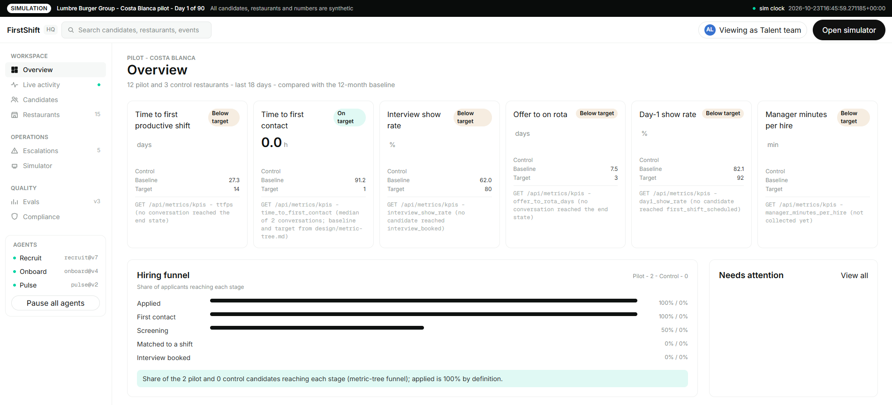
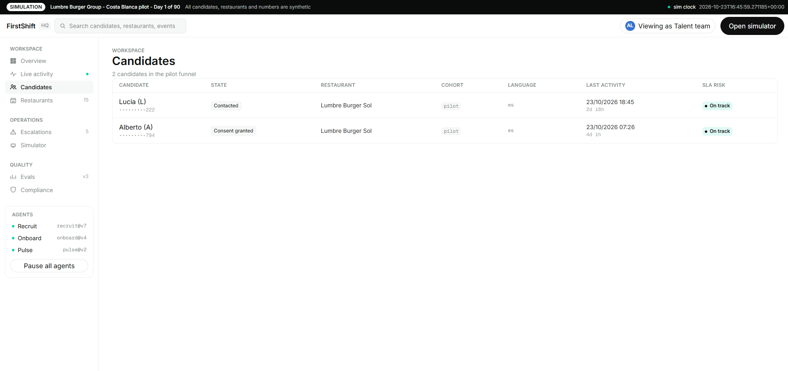
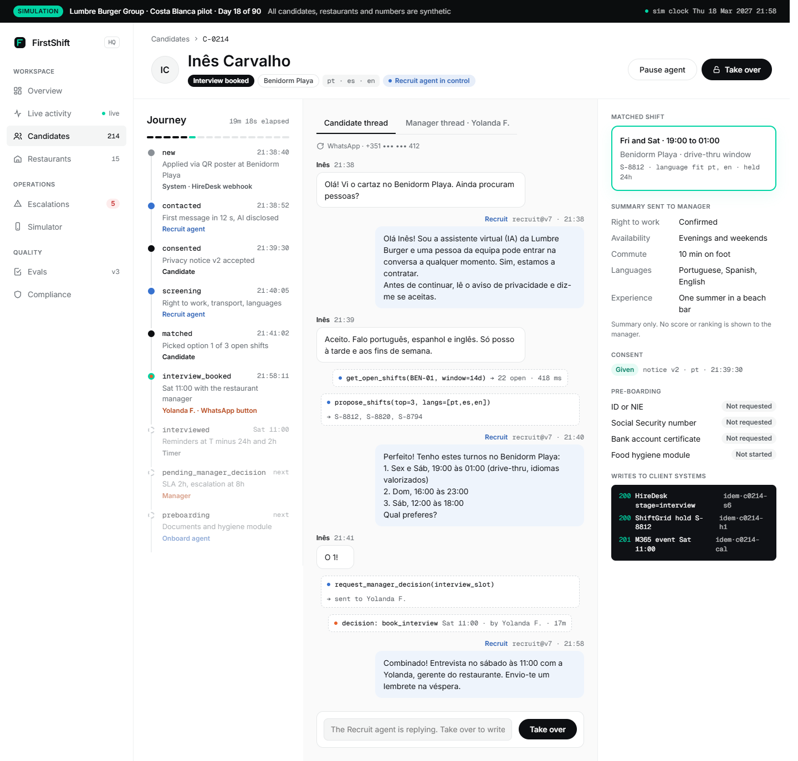
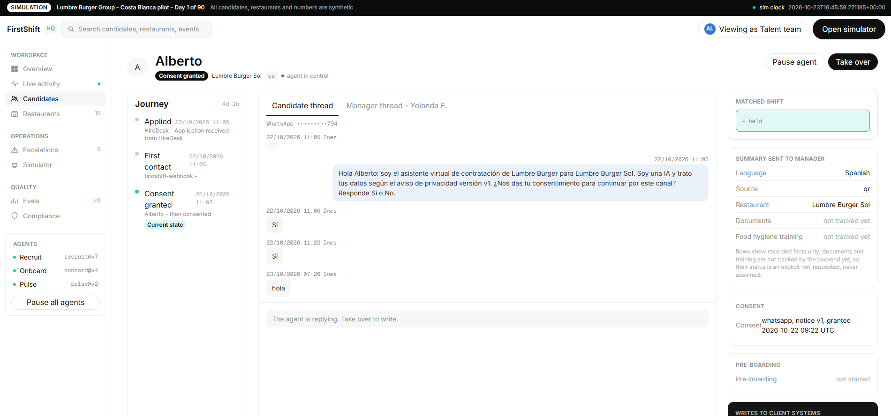
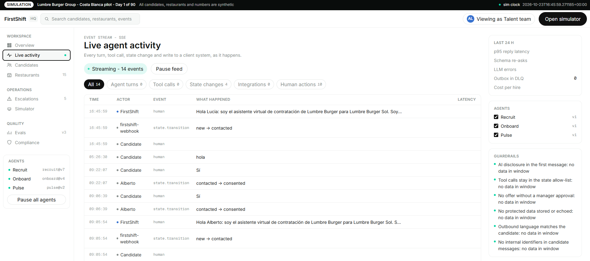
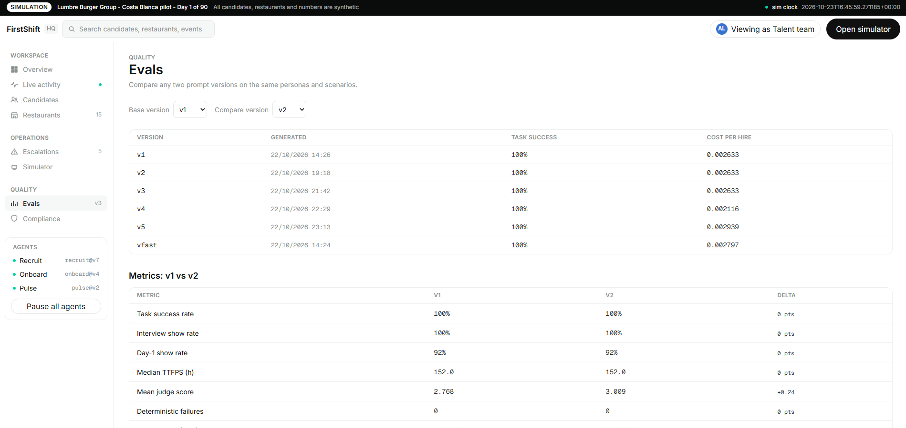
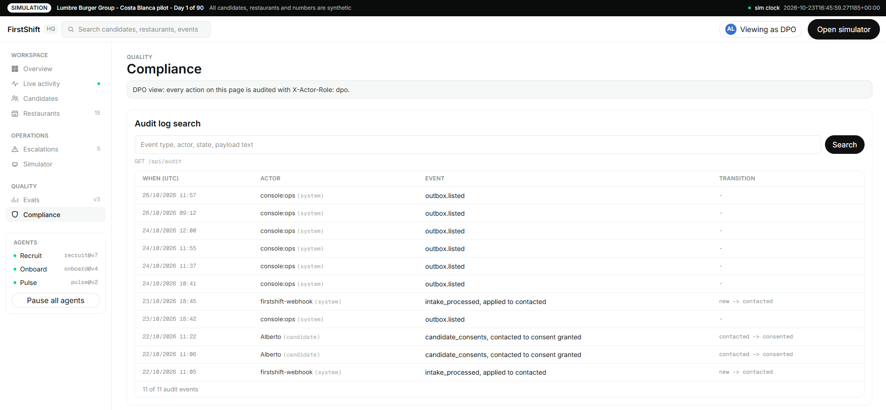
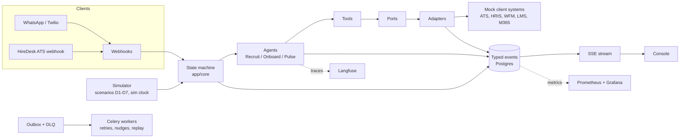

# FirstShift

**FirstShift takes a restaurant staffing gap all the way to a new crew member working their first productive shift, through WhatsApp, with AI agents that humans can see, pause and overtake at any moment.**

FirstShift is a full agent deployment for a (fictional) quick-service restaurant group, Lumbre Burger Group, built end to end: discovery, problem framing, solution design, a working agent backend, an oversight console, an evaluation harness and the operational documentation to run a 90 day pilot.

> All client data, names, systems and numbers in this repository are fictional and exist only to make the simulation realistic. Any resemblance to a real company is not intended.

---

## The problem

Quick-service hiring is not a screening problem. It is a **time-to-first-productive-shift** problem.

When a burger restaurant needs crew for next weekend, the clock is already running: an empty shift means overtime for the team on duty. But recruiting, onboarding and scheduling are owned by three different teams with three different systems, and the candidate falls through the gaps between them. In the client's baseline a new hire takes about 12 days from applying to their first productive shift, most of it waiting for a human to move their file to the next step.

FirstShift treats the **first worked shift as the conversion event** and orchestrates everything upstream of it: first contact in seconds instead of days, consent and screening in the candidate's language, shift matching against real open shifts, manager approval where a human decision is required, onboarding and training, and a check-in after the first shifts to catch churn early.

**Non-negotiable design rules** (full set in `AGENTS.md`):

1. Deterministic core, LLM at the edge. The hiring process is a state machine in plain Python. The LLM never decides transitions, eligibility or scheduling; it talks to people, extracts structured data into validated schemas and summarizes for humans.
2. Humans own consequential decisions. The system never rejects a candidate and never sends an offer without manager approval. Every decision is logged with who, what, when and why.
3. Ports and adapters. Every client system (ATS, HRIS, scheduling, LMS, messaging) sits behind an interface; swapping a mock for a real adapter is configuration, not code.
4. Idempotency everywhere. Inbound webhooks carry idempotency keys; outbound writes go through an outbox relayed with retries and a dead letter queue.
5. Privacy by design. Minimum data, documents referenced by ID, consent captured with notice version and timestamp.
6. Observable or it did not happen. Every agent turn, tool call, state transition and integration write emits a typed event that is persisted and streamed to the console.

---

## What is inside, with screenshots

### Overview: the pilot at a glance

KPI cards with pilot value, control value, baseline and target, each one traced to the endpoint and metric that produces it. The hiring funnel compares pilot against control per stage, and the needs attention strip surfaces SLA breaches, unconfirmed first shifts, conversations waiting for a human, dead letter items and eval alerts.

<p align="center">
  
</p>

### Candidates and the candidate journey

The candidates table tracks state, restaurant, language, last activity and SLA risk. The journey view is the centerpiece: state timeline with the actor of every transition, the WhatsApp conversation with the candidate (Spanish, Portuguese or English) and with the manager side by side, inline tool call markers, the matched shift, the consent record with notice version, pre-boarding status and every write to client systems with its status code and idempotency key. From here a human can pause the agent or take over the conversation.

<p align="center">
  
</p>

<p align="center">
  
</p>

Consent and data minimization are visible in the record rail: documents are never shown, only their status, and personal data is masked by default.

<p align="center">
  
</p>

### Live agent activity: auditability in real time

A server-sent events stream shows every turn, tool call, state transition and integration write as it happens, filterable by kind. Guardrails are always on display: AI disclosed in the first message, no offer without approval, tools restricted by state, outbound language matching the candidate, no internal identifiers in candidate messages.

<p align="center">
  
</p>

### Evals: iteration with evidence

The eval harness runs synthetic personas through the agents and scores every version: task success, interview and day-1 show rates, median time to first productive shift, judge scores and cost per hire, with version-to-version deltas and deterministic failure counts. Reports live in `evals/reports/` as versioned markdown next to their JSON.

<p align="center">
  
</p>

### Compliance: the DPO view

Audit log search, consent records by notice version and erasure request handling. The console encodes the acting role on every action, and the audit trail shows who did what, when and why.

<p align="center">
  
</p>

---

## The three agents

| Agent | Job | Boundary |
|---|---|---|
| **Recruit** | First contact, consent, screening, shift proposal, interview booking | Proposes; a manager approves every offer |
| **Onboard** | Documents checklist, food hygiene training, pre-boarding nudges | Tracks and reminds; never validates identity alone |
| **Pulse** | Day-1 and week-1 check-ins, early churn signals, rota conflict flags | Flags; a human follows up |

All three run on the same contract: versioned prompts in `app/prompts/`, tool use through Strands Agents on the OpenAI API (model configurable by env), structured outputs validated against Pydantic schemas, a re-ask on invalid output and never a guess, and full tracing to Langfuse.

## Architecture



- **Backend** (`app/`): FastAPI, SQLAlchemy 2, Celery + Redis, Postgres. State machine and policies are pure Python with no I/O; adapters isolate every client system; the outbox relay, nudges and escalations run as Celery tasks.
- **Simulator** (`app/sim/`): seven demo scenarios (happy path, evenings and weekends, Portuguese speaker, confirmation cutoff with backup, manager SLA escalation, prompt injection, data erasure) driven by a controllable sim clock, plus synthetic personas for evals.
- **Console** (`web/`): React 19, TypeScript strict, Tailwind v4 with a token-mapped design system, TanStack Query, SSE live updates, Vitest + Testing Library.
- **Observability**: Langfuse for every LLM call, Grafana + Prometheus for metrics (`ops/`), Sentry SDK hook for errors.
- **Evals** (`evals/`): persona generator, deterministic checks, LLM judge with rubrics, red team report and calibration notes.

## Repository structure

```
app/
  agents/        # Recruit, Onboard, Pulse: base, tools, schemas, tracing
  prompts/       # Versioned prompt files (recruit.v1.md, ...)
  core/          # State machine, policies, inbound routing, degraded mode
  api/           # Webhooks, simulator, SSE stream, console API, health
  ports/         # Interfaces to client systems
  adapters/      # hiredesk, shiftgrid, nomina360, learnbite, m365, twilio
  services/      # Scripted behaviors for the sim
  sim/           # Scenarios D1-D7, sim clock, dispatch, runner
  workers/       # Celery: outbox relay, nudges, escalations
  db/            # Models and events
  outbox/        # Outbox and DLQ
mocks/           # Mock client systems with seed data
evals/           # Personas, checks, judge + rubrics, reports (v1-v5, red team)
web/             # FirstShift Console (React + TypeScript + Tailwind)
  src/api/       # Generated types + typed client
  src/features/  # overview, live, candidates, journey, evals, compliance
  e2e/           # Playwright flows
design/          # Concept, architecture, state machine, guardrails, ADRs
discovery/       # Stakeholder interviews, as-is process, funnel baseline
docs/            # Runbook, rollout plan, reliability, security, pilot sims
ops/             # Grafana and Prometheus configuration
specs/           # Phase specifications (source of truth)
tests/           # Backend pytest suite
odd/tasks/       # Feature documents written during development
```

## Current state

- Discovery, problem framing and solution design are complete, with their outputs in `discovery/`, `design/` and `specs/`.
- The backend runs the full happy path and the seven simulator scenarios end to end on mock client systems: webhook intake, consent, screening, shift match, manager decision, interview booking, onboarding, day-1 check-in.
- The console is integrated with the backend API (live events, candidates, journeys, evals, compliance) and covered by component tests; the full stack runs in Docker with one command.
- Five eval iterations plus a red team pass and a calibration note are documented in `evals/reports/`.
- Pilot simulations for day 30 and day 90, the runbook, the rollout plan and the security and compliance notes are in `docs/`.
- CI (`.github/workflows/ci.yml`) runs backend pytest, ruff and mypy, console vitest, ESLint, tsc and build, and compose validation on every push and pull request.

## Quick start

```bash
cp env.example .env                 # fill in OPENAI_API_KEY and the rest
docker compose up -d --build       # full stack
```

| URL | What |
|---|---|
| http://localhost:5173 | FirstShift Console |
| http://localhost:8001/docs | API (OpenAPI; the container serves 8000, host port 8001) |
| http://localhost:3000 | Langfuse |
| http://localhost:3001 | Grafana (admin / GRAFANA_ADMIN_PASSWORD) |
| http://localhost:9090 | Prometheus |

Run tests and checks locally (faster than inside Docker):

```bash
# Backend (Python 3.12, uv)
uv sync
docker compose up -d postgres redis
uv run pytest
uv run ruff check .
uv run mypy app

# Console (web/, pnpm)
cd web
pnpm install
pnpm test
cd ..
```

`make up`, `make down`, `make logs` and the `make backend-*` / `make console-*` targets wrap all of the above.

## Git workflow

- `dev` is the integration branch; `feature/...` and `fix/...` branches come from it and merge back through pull requests.
- `main` only receives demo-ready merges from `dev`, and is synced back into `dev` automatically after every merge.
- Secrets never live in the repository: configuration arrives through environment variables (`env.example` documents the shape, `.env` is gitignored).
