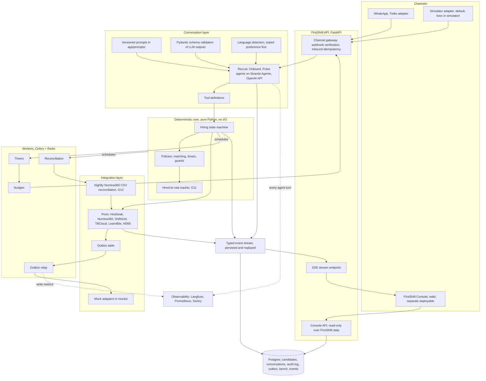

# Architecture: FirstShift

- **Phase:** 3, solution design (spec: `specs/03-solution-design.md` section 6, S4).
- **Rule (spec, verbatim):** "Write `architecture.md` with a component diagram (Mermaid) and a short explanation of each box" covering channel gateway, conversation layer, core, integration layer, workers, event stream, console, and data, plus ADRs for at least the five listed decisions.
- **Scope note:** this session owns backend and infra only. The FirstShift Console is described at spec level; a parallel session (`feature/console-ui`) owns `web/`. Sibling documents: `design/concept.md`, `design/agents.md`, `design/state-machine.md` (phase 2, part A), `design/data-model.md` and `design/integration-contracts.md` (this part), `design/guardrails.md`.

## Component diagram

## Boxes

### Channel gateway (inside the FastAPI app)

Receives inbound WhatsApp messages through two adapters behind one `MessagingChannelPort`: the **simulator adapter** (default, in `simulator/`, used by the console demo simulator and tests) and the **Twilio WhatsApp adapter** (the governed channel that replaces shadow-IT personal WhatsApp, which the DPO cannot search or erase [T-laura-12, T-laura-14]). The gateway verifies webhook signatures before parsing, and deduplicates on the provider message id so a replayed webhook produces no duplicate conversation turn; HireDesk webhook delivery semantics are unconfirmed in evidence, so inbound idempotency is applied to every webhook source, not only messaging [T-hugo, interviewer notes]. Outbound messages are never sent inline from agent code: they are enqueued as events and delivered through the outbox relay, so a channel outage degrades into retries instead of lost messages.

### Conversation layer

Three agents (Recruit, Onboard, Pulse; roles in `design/agents.md`) run on Strands Agents with the OpenAI API, model configurable via env. Prompts are versioned files in `app/prompts/` so eval reports can pin a prompt version (architecture rule 6). Agents hold only two capabilities: talk in natural language and call tools. Every structured value the LLM produces (extracted answers, language choice, intent) is validated against a Pydantic schema; invalid output triggers a re-ask, never a guess (architecture rule 1). Language is resolved from the candidate's stated preference, never guessed from names [T-candidate-c-22, C-O4]. Agents never call a client system and never set state; they call tools that call the core.

### Deterministic core

The hiring state machine (`design/state-machine.md`), matching policies, timer definitions and guards, as pure Python with no I/O and full unit tests. The core decides every transition; the LLM never does (architecture rule 1). It owns the guards that matter most: no `offer_sent` without a recorded human approval, no `not_selected` without a human actor [T-jordi-22, C-L6], no `first_shift_scheduled` without Nómina360 completion confirmed through the nightly CSV or a recorded People Ops exception [T-yolanda-20, T-sofia-18], and food-handling shifts gated on the LearnBite hygiene module, never on hiring [T-iker-06, C-L8]. The **hired-to-rota tracker (O11)** lives here as state plus policy: per hire, which document is late, when the Nómina360 creation was requested and where it sits in its observed 3-to-6-day range [T-yolanda-20], and when the rota can unlock given the ShiftGrid Thursday lock [T-hugo-12], surfaced as a daily WhatsApp status line that drives one action per state, not just display.

### Integration layer

One port per client system: HireDesk, Nómina360, ShiftGrid, TillCloud, LearnBite, Microsoft 365 (contracts in `design/integration-contracts.md`). Mocks in `mocks/` implement the same contracts; swapping a mock for a real adapter is configuration (architecture rule 2). Every outbound write goes to the **outbox table** first and is relayed by a worker with retries and backoff (architecture rule 4, ADR-003). The **nightly Nómina360 CSV reconciliation (O12)** is the truth gate: the API's own confirmations are not trusted, because Nómina360 returns HTTP 200 with an error body on validation failures [T-hugo-16, T-hugo-20]; a write only becomes "confirmed" when the next CSV shows it [T-hugo-18, C-T4]. The Nómina360 write path is limited to validated employee-creation payloads routed through People Ops' flow (C-L9, [T-sofia-04]).

### Workers (Celery + Redis)

- **Timers:** execute the state machine's scheduled events (no-reply nudges at 2 h and 24 h, interview reminders, manager decision SLA at 2 h and 8 h, first-shift confirmation cutoff at T minus 18 h).
- **Nudges:** compose and send reminder messages through the channel gateway, using templates per state and language.
- **Outbox relay:** delivers pending outbox messages to client adapters with idempotency keys, retries and backoff, and records each attempt.
- **Reconciliation:** runs the O12 nightly job, downgrades writes the CSV does not confirm, and opens reconciliation tasks for People Ops and alerts for IT [T-hugo-30].

### Event stream

Every agent turn, tool call, state transition, timer firing and integration write is appended to Postgres as a typed event and streamed to the console over Server-Sent Events (architecture rule 7). This is the compliance surface the DPO asked for ("show me the logs" [T-laura-18]) and the observability surface IT asked for ("monitoring and alerts on those writes, not a phone call from payroll on payday" [T-hugo-30]). If it is not visible in the console, it did not happen.

### FirstShift Console (spec level only)

React + TypeScript + Tailwind on Vite, a **separate deployable** that talks only to the FirstShift API: live agent activity, candidate journeys, human takeover, metrics, escalations, evals, compliance views and the demo simulator. Audience is HQ only (Talent, DPO, Ops leadership); managers never use it and never log in anywhere (C-O1, [T-raul-26]). Full spec: `specs/04b-console.md`. The parallel `feature/console-ui` session owns `web/`; this diagram includes it only as a deployment boundary.

### Data

Single Postgres cluster (EU region, C-T8) holding the candidate record, conversation log, audit log, outbox, bench and event stream, partitioned by brand and restaurant from day one (C-O3). Entities, ownership and retention per field: `design/data-model.md`. Redis backs Celery. Candidate documents are referenced by ID in EU object storage and never logged (architecture rule 5).

## Observability integration points

- **Langfuse:** one trace per agent turn, started in the conversation layer, tagged with candidate id, agent role, prompt version and state; the hook point is the agent runtime wrapper, so no agent code touches Langfuse directly. LLM traces are how evals and guardrail reviews reference prompt versions.
- **Prometheus:** `/metrics` on the API and on each worker process: outbox depth and age, retry counts, reconciliation mismatch count (O12), timer lateness, message send failures. These are the alerts IT asked for on client writes [T-hugo-30].
- **Sentry:** DSN via env (`SENTRY_DSN`), initialized in the FastAPI app and Celery workers; every unhandled error in an agent turn, relay attempt or reconciliation run is captured with the correlation id from the event stream. No candidate document contents and no conversation text beyond what is already persisted.

## ADRs (required five, file set to be filled in `design/adr/`)

| ID | Title (stub, one line each) |
|---|---|
| ADR-001 | Deterministic core vs LLM-driven flow: the state machine decides, the LLM talks and extracts, and every LLM output that feeds the core is schema-validated. |
| ADR-002 | The open shift is the unit of work: matching targets concrete ShiftGrid open shifts, while a HireDesk requisition is still created for Talent control and reporting [T-candidate-a-20, T-churned-14]. |
| ADR-003 | Outbox pattern for all client writes: idempotent by a key IT controls, relayed with retries, verified by the nightly CSV where the system is Nómina360 [T-hugo-22, T-hugo-24, C-T5]. |
| ADR-004 | WhatsApp buttons for manager decisions instead of a dashboard: every manager-owned decision is one message with two or three quick replies, logged with who, what and when [T-yolanda-14, T-raul-26, C-O1, C-O2]. |
| ADR-005 | Bench consent and retention: re-engagement happens only with per-channel consent captured with notice version and timestamp, an expiry, and end-to-end erasure like any candidate record [T-laura-26, T-laura-12, C-L1, C-L4, C-L5]. |
