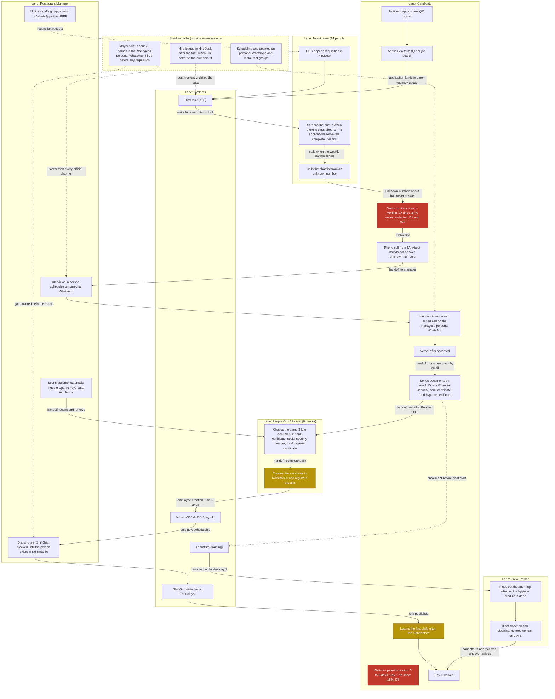

# As-is process map: crew hiring at Lumbre Burger Group

- **Scope:** how a crew hire actually happens today, from staffing gap to first worked shift.
- **Evidence:** the 12 interviews in `discovery/transcripts/`, the observation log `discovery/ride-along-benidorm.md`, and the baseline table in `specs/00-client-brief.md` section 4. Every claim cites a transcript line (`[T-name-NN]`), the ride-along, or a spec section. Times and numbers come only from those sources.
- **Method note:** elapsed times are medians from the brief where available, otherwise single observed values from transcripts, labeled as such.

## The as-is flow

Shadow paths are shown in a dotted lane. **W1, W2, W3** mark the 3 longest waits; **D1, D2, D3** mark the 3 highest drop-off points. All edges crossing a lane boundary are handoffs where work waits for a human.

### The 3 longest waits (W1 to W3)

| # | Wait | Evidence |
|---|---|---|
| W1 | Application to first contact: median 3.8 days, and 41% of applicants are never contacted at all. The queue is per vacancy and is looked at "if there is someone looking", roughly 1 application in 3. | `specs/00-client-brief.md` section 4; [T-jordi-04, T-jordi-06, T-jordi-14] |
| W2 | Verbal offer to first worked shift: median 9 days company-wide, 11 days observed for Yolanda's last hire. Inside it: document chasing (the same 3 documents late every time, 3 to 4 reminders per document) plus employee creation in Nómina360, which takes 3 to 6 days and gates everything. | `specs/00-client-brief.md` section 4; [T-yolanda-10, T-yolanda-12, T-yolanda-20]; [T-sofia-10, T-sofia-12]; [T-sofia-14] documents a 5 extra-day loss on the hygiene certificate alone |
| W3 | Rota visibility for the new hire: ShiftGrid only locks the rota on Thursdays [T-hugo-12], so the first shift is learned the night before, around 22:30 in the churned hire's case, or by chance from a crew WhatsApp group in candidate A's case. | [T-hugo-12]; [T-churned-08, T-churned-16]; [T-candidate-a-16, T-candidate-a-18] |

### The 3 highest drop-off points (D1 to D3)

| # | Drop-off | Rate | Evidence |
|---|---|---|---|
| D1 | Applicants never contacted | 41% | `specs/00-client-brief.md` section 4; [T-jordi-14] (he knows it by complaints, not reports) |
| D2 | Interview no-show | 38% | `specs/00-client-brief.md` section 4; consistent with phone tag on unknown numbers [T-jordi-14] and slow scheduling |
| D3 | Day-1 no-show (hired but never shows up) | 18%, with 52% of new hires gone within 90 days | `specs/00-client-brief.md` section 4; the waiting window between signing and being schedulable is the mechanism [T-yolanda-10, T-yolanda-20, T-yolanda-22]: she lost a signed candidate to a competitor after 4 days of it |

### Shadow paths

1. **The maybes pool.** Yolanda keeps about 25 ex-employees, friends of crew and walk-ins in her personal WhatsApp and hires from it before anyone opens a requisition: "before anyone upstairs even opens a requisition, I have the person for Saturday" [T-yolanda-14, T-yolanda-16]. Her last hire, Laura, was contacted first by her, inverting the funnel [T-yolanda-08].
2. **Personal WhatsApp scheduling.** Interviews, rota answers, shift swaps and first-shift information all travel on personal numbers and restaurant groups [T-yolanda-06; T-churned-10, T-churned-16, T-churned-20; T-candidate-a-16, T-candidate-a-18]. IT calls it shadow IT that cannot be backed up, audited or turned off [T-hugo-26]; the DPO cannot fulfill a deletion or access request over it [T-laura-12].
3. **Post-hoc HireDesk logging.** Shadow hires are entered into HireDesk late, when HR asks, "so the numbers fit" [T-yolanda-18; ride-along, 19:30 row]. The reverse also happens: people who passed through the stack and were hired informally with no record [T-jordi-20]. This is why the Head of TA calls his own funnel reports garbage and trusts only application date and phone number [T-jordi-16, T-jordi-18].

The shadow paths are also the fastest paths. During a full Saturday observation, 13 hiring-related interruptions and roughly 105 minutes of hiring work happened, 4 copy-paste events between systems, and none of the day's hiring work happened in HireDesk (`discovery/ride-along-benidorm.md`, Counts section). Manager time on hiring is ~6 hours per week per restaurant (`specs/00-client-brief.md` section 4).

## The process HQ described vs the process that actually runs

HQ describes a linear funnel: gap to HRBP, requisition in HireDesk, job boards, central screening, phone call, manager interview, documents by email, payroll setup in Nómina360, rota in ShiftGrid, training in LearnBite (`specs/00-client-brief.md` section 2). What actually runs is three processes wearing one name. The fastest one is the manager's own: a walk-in or a maybes message on personal WhatsApp covers the gap days before a requisition exists, and the paperwork is logged backwards into HireDesk only if someone asks [T-yolanda-08, T-yolanda-16, T-yolanda-18; T-jordi-20]. The official one is a queue that loses people at the entrance: 41% never contacted, screening that filters out exactly the student and first-job profiles that convert best for weekend shifts [T-jordi-08], and a phone channel that half of candidates will not answer [T-jordi-14]. And the third is a silent gap nobody owns: between "she said yes" and "she can be scheduled" sit the documents, the Nómina360 creation (3 to 6 days) and the Thursday rota lock, and during that window the candidate is a promise, not an employee [T-sofia-18; T-yolanda-20; T-hugo-12], long enough for a competitor three streets away to win her [T-yolanda-22]. The systems HQ lists as a tidy chain are in practice connected by the manager retyping data between them, four copy-pastes observed in a single Saturday (`discovery/ride-along-benidorm.md`), and the strongest scheduling intelligence in the area is a director's memory and his phone [T-raul-04, T-raul-18].
