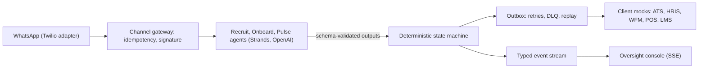

# From "screen faster" to first productive shift: a Forward Deployed Engineering case study

> Everything here is a simulation: the client is fictional and every number
> is a stated assumption from the brief (`specs/00-client-brief.md`) or a
> simulated outcome from this repository's pipeline and eval harness.

## 1. Context

Lumbre Burger Group is a fictional Iberian quick-service operator: 310
restaurants, about 11,000 hires a year, and 52% of new hires leaving within
90 days (`specs/00-client-brief.md`). Coastal units add 25% to 40% headcount
every summer; last summer 11 restaurants closed their drive-thru lane at
peak for lack of staff. The signed engagement is a 90-day paid pilot in 12
company-operated restaurants in Alicante, with 3 comparable controls.

## 2. What I found

Discovery replaced the HQ description of hiring with what actually happens
(`discovery/insights.md`). The three strongest insights:

1. **First-contact speed decides who wins the candidate, and 41% of
   applicants are never contacted.** One candidate applied to six chains in
   one evening and took the only one that answered within the hour
   ([T-candidate-a-08 to T-candidate-a-12]); the seeded funnel shows a 3.9-day
   median to first contact (`discovery/funnel-baseline.md`).
2. **The hired-to-rota window is the largest time sink and nobody owns it.**
   Between the verbal yes and the first schedulable shift sit the three
   chronically late documents, a 3-to-6-day HRIS employee creation and a
   Thursday rota lock ([T-yolanda-20], [T-sofia-18], [T-hugo-12]): 5.1 median
   days, the biggest stage gap in the funnel.
3. **Managers already run the informal talent pool the system lacks, on
   personal WhatsApp.** One manager keeps about 25 "maybes" and hires from
   that list before any requisition exists ([T-yolanda-14, T-yolanda-16]);
   the ride-along showed none of a Saturday's hiring happened in the ATS
   (`discovery/ride-along-benidorm.md`).

## 3. The reframe

The ask was "screen faster". The discovery numbers say hiring is not a
screening problem: it is a **time-to-first-productive-shift (TTFPS)**
problem. Recruiting, pre-boarding and scheduling are owned by three teams
and three systems, and the signed hire falls through the gap between them.
The north star became the first worked shift.

## 4. What I built

One sentence: **FirstShift fills a specific open shift with a person who is
ready to work it, by running recruiting, pre-boarding, scheduling and the
first week as one conversation, with managers deciding from WhatsApp and
every client system kept as the source of truth** (`design/concept.md`).

The LLM never decides anything consequential: a plain-Python state machine
owns every transition, eligibility check and timer, and the agents only
talk, extract schema-validated data and summarize (ADR-0001). Every outbound
write goes through an outbox with retries and a dead-letter queue; payroll
truth is the nightly CSV reconciliation, not the API's 200 responses
(ADR-0003, ADR-0007). Every turn, transition and write is a typed event,
streamed to an oversight console.

## 5. How I knew it worked

All numbers here are simulation outcomes (seed 42), not real-world effects.

- **Evals:** across five iterations on 44 synthetic personas, task success
  stayed 44 of 44 with 0 deterministic guardrail failures, and four measured
  fixes each took a defect to 0: internal identifiers in candidate messages
  (39 conversations to 0), post-statement language drift (21 messages to 0),
  duplicate consent asks (44 conversations to 0), and
  three-questions-in-one-message conversations (44 of 44 to 0)
  (`evals/reports/eval-v1.md` to `eval-v5.md`, `docs/iteration-log.md`).
- **Red team:** 7 of 7 adversarial classes ended in the designed safe
  behavior, including prompt injection and an offer-without-approval attempt
  (`evals/reports/redteam-v1.md`).
- **Simulated pilot, day 30:** 726 pilot applications through the real
  pipeline against a statistical control arm. In this simulation the contact
  rate was 100% versus 58% in the control model, the median
  application-to-first-shift proxy was 6.3 simulated days versus 26.4, and
  497 first shifts were worked. It also surfaced honest failures: 156
  simulated hires were scheduled and still did not show up on day 1, and 73
  candidates went silent into the bench (`docs/pilot-sim-day30.md`).

## 6. What I would do with a real client next

Run a shadow wave first: agents observe and suggest, nothing is sent to a
candidate, and Talent reviews 50 suggestions (specs/06 section 4, wave 0).
Then sandbox credentials for each client system, a DPIA owned by the DPO,
and a day-to-day champion in operations who owns the weekly review. I would
also staff the human decision queue before launch: the simulation showed
decision SLA breaches are the throughput bottleneck software cannot fix.

## 7. How I worked

The engagement ran as agent-first development in gentle-shell under Organic
Driven Development: specs are the source of truth and are passed by path;
every substantial feature gets a document in `odd/tasks/` with stable IDs
and acceptance criteria; the core is built test-first; and every checkoff
requires observed evidence. One real excerpt, verbatim from
`odd/tasks/iteration-3.md`:

> "We believe dispatching the candidate's consent from the outstanding ask
> before composing the reply (so the ask is emitted only while no consent
> record exists, and a reply to an outstanding ask captures consent first)
> will reduce duplicate consent asks in the transcript from the baseline count
> to 0, and raise the judge's warmth and clarity on the affected
> conversations, because evidence E: the only source of the duplicate ask is
> the `("new", "contacted")` branch composing before its own `capture_consent`
> tool call runs, and every affected transcript shows exactly one duplicate."

The measured result: duplicate consent asks 44 to 0, deterministic checks
green, cost per simulated hire down from 0.002633 to 0.002116 USD. Each
keep/revert decision rests on the exact deterministic metric, never the
noisy judge mean. That discipline is the part I would bring to a real
deployment unchanged.
