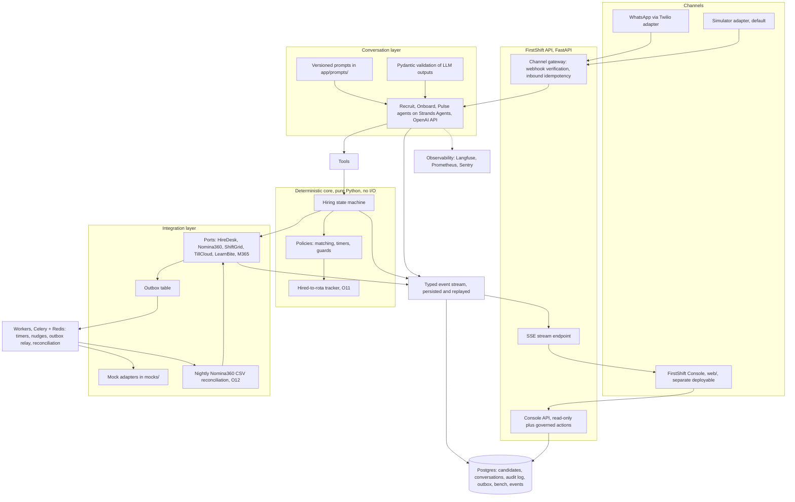

# FirstShift handover pack

For the next engineer who picks this up and for Lumbre Burger Group. Everything
here is traceable to a file in this repository. The client, its systems and all
numbers are fictional and exist to simulate a realistic deployment.

> Note on scope: `specs/06-integration-rollout.md` section 5 promised
> `docs/runbook.md`, `docs/rollout-plan.md`, `docs/security-and-compliance.md`,
> `docs/pilot-sim-day90.md` and `docs/training/manager-quickstart.md`. None of
> these files exist yet. The operational gaps they would have formalized are
> listed in section 4 below, verified against the code and the feature logs in
> `odd/tasks/`.

---

## 1. What exists, what is stubbed, what is simulated

One table, no ambiguity. "Exists" means implemented with tests. "Stubbed" means
a real interface with a simplified or partial implementation. "Simulated" means
the thing is modelled, not real, and results derived from it are simulation
outcomes.

| Capability | Status | Evidence |
|---|---|---|
| Deterministic hiring state machine, guards, timers, bench, tracker | **Exists** | `app/core/`, `design/state-machine.md`, `odd/tasks/walking-skeleton.md`, `odd/tasks/integration-hardening.md` |
| Conversation agents (Recruit, Onboard, Pulse) with versioned prompts and Pydantic-validated outputs | **Exists** | `app/agents/`, `app/prompts/recruit.v1.md`, `onboard.v1.md`, `pulse.v1.md`, `odd/tasks/agents-simulator.md` |
| Live OpenAI model path in conversations and evals | **Simulated** for measurement: evals and the pilot run a scripted stand-in model; `tests/test_scenarios.py` calls it a "recorded-replay stand-in for live model calls". The agent loop path exists (`app/sim/agent_loop.py`) | `odd/tasks/agents-simulator.md`, `evals/run.py` |
| Messaging channels: simulator adapter (default) and Twilio WhatsApp adapter | **Exists** (adapters, signature check, opt-out keywords, 24h-window refusal); template registration with Twilio is a client setup step, not done | `odd/tasks/twilio-channel.md`, `docs/integration-guide.md` section 7 |
| Mock client systems: HireDesk, Nómina360, ShiftGrid, TillCloud, LearnBite, M365 | **Simulated**, deterministic fault injection included | `mocks/`, `mocks/faults.py`, `docs/integration-guide.md` |
| Outbox with retries, backoff, dead-letter queue and human replay | **Exists** | `app/outbox/`, ADR-0003, `tests/test_dlq_replay.py`, `docs/reliability.md` |
| Per-adapter health checks, degraded-mode gating, holding messages | **Exists** | `app/core/degraded.py`, `tests/test_degraded_mode.py`, `docs/reliability.md` |
| Nómina360 nightly CSV reconciliation (O12) | **Exists**; the reconciliation task is a Pydantic model, not a DB row (named follow-up) | `app/adapters/nomina360.py`, `odd/tasks/integration-hardening.md` L5 |
| Alerts and pager plumbing | **Stubbed**: the four alert rules are documented queries over persisted data, none wired to a real pager; the first-contact SLO is enforced structurally but not measured on a dashboard | `docs/reliability.md`, "What is documented but not wired" |
| FirstShift Console (React): Overview, Live, Candidates, Restaurants, Ops, Evals, Compliance, Simulator | **Exists** for the named routes, backed by the console API; `/compliance` is the DPO view (audit search, consent records grouped by notice version, erasure requests) with its backend gaps rendered honestly in the UI | `web/src/App.tsx`, `odd/tasks/console-api.md`, `odd/tasks/console-views.md` |
| Eval harness, 44 synthetic personas, deterministic checks, fairness table | **Exists**; the default judge (`scripted-judge/v0`) is a deterministic digest, **not** a real LLM judge; the live judge was calibrated once | `evals/run.py`, `evals/reports/eval-v5.md`, `evals/reports/calibration-v1-report.md` |
| Red-team suite (7 adversarial classes) | **Exists**, 7 of 7 pass | `evals/reports/redteam-v1.md` |
| Pilot (day-30 ops review) | **Simulated**: synthetic personas, scripted managers, a statistical control arm; no day-90 report exists | `docs/pilot-sim-day30.md` |
| Demand-triggered requisitions (O3), crew referrals (O9), voice (O10) | **Not built**, deliberately out of pilot scope | `design/concept.md`, `design/decision-matrix.md` |
| GDPR erasure to the designed end state | **Stubbed**: request is observable, processing stops, retention clock starts, audit is kept; the erased state with a pseudonymized audit tombstone (design row 32) is designed but not implemented | `tests/test_scenarios.py`, `odd/tasks/agents-simulator.md` L5 |
| First-shift day-before confirmation | **Stubbed**: the commitment engine is designed (specs/03 section 3.6) but the seven candidate-facing message templates contain no first-shift confirmation template, so the designed day-before confirmation is not a delivered message yet | `docs/iteration-log.md` iteration 1 (template list), `specs/03-solution-design.md` |

## 2. Run, test, evaluate and deploy in 10 commands

Prerequisites: Docker, Python 3.12 with `uv`, Node with `pnpm`.

```bash
cp env.example .env                                             # 1. configure (OPENAI_API_KEY etc.)
docker compose up -d --build                                    # 2. run and deploy the full stack (API 8001, console 5173, Langfuse 3000, Grafana 3001); this compose stack is the deployment unit (make up / make down are shortcuts)
uv sync                                                         # 3. backend deps for tests and evals
docker compose up -d postgres redis                             # 4. only what tests and evals need from the host
uv run alembic upgrade head                                     # 5. database schema (default URL points at the compose postgres on localhost:5433)
uv run pytest                                                   # 6. backend tests (lint: uv run ruff check . / types: uv run mypy app)
cd web && pnpm install && pnpm test && pnpm typecheck && pnpm lint   # 7. console tests, types and lint
uv run python -m evals.run --suite full --seed 42 --label v6    # 8. run the eval suite (44 personas, report lands in evals/reports/; the runner creates its own throwaway schema and migrates it)
uv run python -m evals.judge.calibration emit --report evals/reports/eval-v6.json   # 9. write the 15-conversation labeling worksheet; a human fills the labels between steps 9 and 10
uv run python -m evals.judge.calibration score --worksheet evals/reports/calibration-v1.md --judge live --report evals/reports/eval-v6.json   # 10. live-judge agreement (steps 9 and 10 need OPENAI_API_KEY)
```

Entry points: console at http://localhost:5173 (simulator at `/simulator`),
OpenAPI docs at http://localhost:8001/docs. Deploying is command 2: the same
compose stack is the deployment unit, and `make up` / `make down` wrap it. A
new engineer can run the eval suite end to end with the commands above in
well under 15 minutes.

## 3. Architecture in one diagram

Three agents talk on WhatsApp; a deterministic core owns every state
transition; all client writes go through an outbox; every event is persisted
and streamed to the console.



Design decisions behind the boxes, each with its rationale and evidence:

- [ADR-0001](../design/adr/ADR-0001-deterministic-core.md): deterministic core, LLM only talks and extracts.
- [ADR-0002](../design/adr/ADR-0002-open-shift-unit-of-work.md): the open shift is the unit of work.
- [ADR-0003](../design/adr/ADR-0003-outbox-pattern.md): outbox pattern for all client writes.
- [ADR-0004](../design/adr/ADR-0004-whatsapp-buttons-no-dashboard.md): manager decisions as WhatsApp buttons, no dashboard.
- [ADR-0005](../design/adr/ADR-0005-bench-consent-retention.md): bench consent and retention.
- [ADR-0006](../design/adr/ADR-0006-promise-to-payroll-ownership.md): promise-to-payroll ownership.
- [ADR-0007](../design/adr/ADR-0007-csv-truth-reconciliation.md): CSV as the reconciliation truth.

Full component descriptions: `design/architecture.md`. Ports and per-system
contracts: `docs/integration-guide.md`.

## 4. Open risks and known limitations, ranked

Every results statement in this repository that cites a number is a simulation
outcome, and the pilot control arm is a statistical model, not a run of the
code (`docs/pilot-sim-day30.md`).

1. **Managers are scripted in the pilot simulation.** Approvals are instant,
   interviews always attended, documents complete on request, so the simulated
   pilot cannot reproduce the human bottlenecks discovery found
   (`docs/pilot-sim-day30.md`, "Limits of this simulation"). The 72 manager
   decision SLA breaches in 30 simulated days are the one place the simulation
   does stress a human queue, and staffing that queue is a client decision
   before launch.
2. **Restaurant pause is not consulted by the dispatch paths.** The console
   action `POST /api/restaurants/{id}/pause` writes a `restaurant.paused`
   audit event (`app/api/console/actions.py`), but neither `app/sim/dispatch.py`
   nor `app/services/scripted.py` checks the paused flag before sending, so a
   paused restaurant's agents still fire. The runbook operation the console
   advertises does not yet stop the machines.
3. **No erasure tombstone.** The designed end state (erased with a
   pseudonymized audit tombstone, `design/state-machine.md` row 32) is not
   implemented: D7 asserts the implemented safe behavior only (request
   observable, processing stops, retention clock starts, audit kept)
   (`tests/test_scenarios.py`, `odd/tasks/agents-simulator.md` L5).
4. **No first-shift confirmation template.** The commitment engine's
   day-before confirmation (specs/03 section 3.6) has no candidate-facing
   template in the delivered catalog: the whitelist
   `CANDIDATE_FACING_TEMPLATES` in `app/services/scripted.py` (offer,
   rejection, nudges, interview reminder, bench messages, escalation,
   document review) contains no first-shift confirmation, so the designed
   confirmation is not a sent message yet; the 156 simulated day-1 no-shows
   in the pilot (`docs/pilot-sim-day30.md`, labelled simulation) are exactly
   the failure this template is meant to cut.
5. **First-shift scheduling without the FirstShift row.** The scheduled shift
   is evidenced by the outbox write and the state transition only; the
   FirstShift-side row for the scheduled shift was deferred
   (`odd/tasks/walking-skeleton.md` L4), which weakens the audit surface for
   the single most consequential write.
6. **Alerts are not wired to a pager.** Four documented alert rules (DLQ age,
   reconciliation drift, SLA breach rate, LLM error rate) are queryable but
   have no Grafana/Alertmanager rules; the first-contact SLO is not measured
   (`docs/reliability.md`).
7. **Judge quality.** The default eval judge is a deterministic digest, not a
   model; the one live-judge calibration (15 conversations, gpt-4.1-mini)
   showed exact agreement 17% and within-1 agreement 48% against human labels,
   kept as the stricter reference (`evals/reports/calibration-v1-report.md`).
   Judge means must never be the sole basis of a keep/revert decision; the
   iteration log already treats them as noise.
8. **Documents promised by the specs do not exist:** `docs/runbook.md`,
   `docs/rollout-plan.md`, `docs/security-and-compliance.md`,
   `docs/pilot-sim-day90.md`, `docs/training/manager-quickstart.md` (see the
   note at the top). The DPIA is an outline obligation, not a document.
9. **Auth details for ShiftGrid, LearnBite, TillCloud, M365 are build-time
   confirmations**, and Twilio template registration is a client-side setup
   step (`docs/integration-guide.md`, `odd/tasks/integration-hardening.md` L5).

## 5. Next three recommended features with expected impact

1. **Demand-triggered requisitions (O3).** TillCloud's 15-minute sales slices
   and the derived labor forecast open the requisition before the manager
   notices the gap. Expected impact: attacks the 7.5% of understaffed peak
   hours in July and August in coastal units (`specs/00-client-brief.md`
   section 4), and moves hiring from reactive to forecast-driven. Precondition
   per discovery: the forecast signal must be measured, not overwritten
   (`design/concept.md` O3 row, [T-raul-18]).
2. **Crew referral loop (O9).** Bench members and current crew can refer
   friends into the same WhatsApp flow, with consent and logging. Expected
   impact: the strongest candidates arrive through people who already work
   there; it converts the manager bench (about 25 "maybes" per manager,
   [T-yolanda-14]) and crew networks into a channel the system can finally
   see, with the ADR-0005 consent rules applied. Discovery scored it low on
   evidence, so ship it behind a measurement plan, not on faith.
3. **Voice screening (O10).** A voice channel for the screening conversation
   where typing is impractical. Expected impact: reach the applicants who do
   not answer or reply in text; discovery evidence currently cuts against it
   (candidates prefer text reply speed, [T-jordi-14]), so it stays v2 until
   the text funnel's residual losses justify the build.

## 6. Ownership after handover

All names below are the fictional client's stakeholders
(`specs/00-client-brief.md` section 7); the split is a recommendation to
confirm at handover.

| Asset | Recommended owner | Why and what they inherit |
|---|---|---|
| Prompts (`app/prompts/*.v1.md`) | Head of Talent Acquisition (Jordi) with the FirstShift product owner | Prompts are versioned so eval reports can pin a version; wording changes must go through an eval run, never edited live. Jordi's team owns what the agent says about the process. |
| Screening criteria and hiring decisions | Head of Talent Acquisition (Jordi) for criteria, restaurant managers for decisions | Architecture rule 3: the system never rejects and never offers without a recorded human approval (ADR-0001, INV-1). Criteria changes are proposals backed by retention data, decided by humans (C-L6). |
| The bench | Restaurant managers own the members; Talent governs the policy | ADR-0005: per-channel consent with notice version and timestamp, expiry, and end-to-end erasure like any candidate record. The bench only has value if managers actually call it (`docs/pilot-sim-day30.md`, simulation). |
| DPIA and privacy | Data Protection Officer (Laura) | specs/06 section 3 assigns the final DPIA to the DPO; she also audits consent versions, the event stream ("show me the logs") and erasure handling, including the tombstone gap in section 4. |
| Operations (runbook, pager, outbox replay) | Integration Lead IT (Hugo) | DLQ replay, degraded mode, adapter health, the alert wiring in `docs/reliability.md`. |
