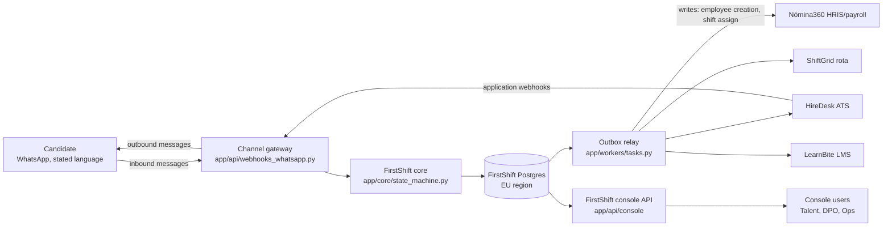

# Security and compliance pack: FirstShift pilot

**Audience:** Hugo Andrade (Integration Lead, IT) and Laura Cebrián (Data Protection Officer).
**Status:** pilot design pack for review and sign-off. It separates, for every topic, what is **implemented today** in this repository from what is **designed for production** and still to build or to sign.
**Sources:** `specs/06-integration-rollout.md` section 3, `design/constraints.md`, `design/guardrails.md`, `design/data-model.md`, `design/adr/ADR-0005-bench-consent-retention.md`. Every claim about code cites the implementing path. Legal obligations are stated as design requirements with their source, never as legal advice.

---

## 1. Data flow

### 1.1 Diagram

No client system is reached outside its documented API; there is no direct database access to client systems (C-T1, INV-7, enforced by the port layer in `app/ports/` and the adapters in `app/adapters/`).

### 1.2 Personal data inventory: what, where, how long, who reads it

Retention values are the pilot defaults from `design/data-model.md`. They are proposals until Laura signs them into the DPIA.

| Personal data field | Where it is stored | Retention | Who can read it |
|---|---|---|---|
| Candidate name (first name only, no surname until Nómina360 registration needs it) | FirstShift Postgres, `Candidate` table (`app/db/models.py`) | Anonymized 12 months after last interaction | Talent and Ops in the console (first name and initials only); the assigned restaurant manager, in WhatsApp |
| Candidate phone | FirstShift Postgres, `Candidate.phone`, channel-scoped | With the candidate record; **masked in the console** (last 3 digits, `mask_phone` in `app/api/console/helpers.py`) | Raw value: the messaging pipeline only. Console: masked for all roles |
| Consent record with notice version | FirstShift Postgres, `Consent` table: channel, purpose, `notice_version`, `granted_at`, `revoked_at`, evidence message | Life of the candidate record, never deleted before it | DPO and Talent in the candidate detail view (`_consent_row` in `app/api/console/read.py`) |
| Document references (ID/NIE, social security, bank certificate, hygiene certificate, contract) | Pointer only: `Document` rows with an `external_ref` to EU-hosted object storage; binaries live with People Ops and Nómina360, never in FirstShift and never logged inline | Pointers deleted at erasure; binaries follow People Ops retention (term to be confirmed by the DPO) | People Ops (the truth); FirstShift tracks chase status only |
| Training status (food hygiene module) | FirstShift caches `TrainingEnrollment.status`; LearnBite is the system of record | With the hire record | Talent and Ops (pre-boarding rows in the console); the crew trainer is notified via WhatsApp |
| Conversation log (candidate, manager, agent messages) | FirstShift Postgres, append-only event log (`app/db/events.py`), streamed to the console over SSE | With the candidate record | Talent and Ops in the journey view; DPO on request for an access request or audit. Replaces the ungoverned personal-WhatsApp threads described in [T-laura-06, T-laura-12] |
| Audit log | FirstShift Postgres, `AuditEvent`, append-only and immutable (INV-5). `occurred_at` is strictly increasing per table (`append_audit` in `app/api/console/helpers.py`) | Pilot default 5 years, pending DPO sign-off; it is the DPIA evidence and the AI Act logging surface (C-L7) | DPO and Talent via `GET /api/audit`; IT by idempotency key end to end for one person (C-T6) |
| Outbox (every outbound write to a client system) | FirstShift Postgres, `OutboxMessage` with validated payload, IT-controlled idempotency key, status incl. `csv_confirmed` | 90 days after terminal status; the audit log keeps the queryable trace | Ops sees writes in the journey view and replays dead letters (`app/api/outbox.py`); IT queries by idempotency key |

Related stores with personal data: `ScreeningAnswer` (validated extraction plus the candidate's own free text; free text is summarized for the manager, never scored, per guardrail G4) and `BenchEntry` (section 4 below). Both follow the candidate's retention.

Deliberately not collected (C-L3, guardrail G3): age beyond the legal minimum check, nationality beyond right to work, health, family situation, religion. Volunteered values are dropped by the extraction validator and logged as `protected_data_refused`; the `ScreeningAnswer` schema has no field that could carry them.

---

## 2. Record of processing activities (ROPA) draft, for the pilot

Owner: Laura Cebrián. Legal basis per purpose is a draft for her confirmation; consent and per-channel enforcement are implemented (section 3), the ROPA artifact itself is a pilot deliverable.

| # | Purpose | Legal basis (draft) | Data categories | Retention | Recipients |
|---|---|---|---|---|---|
| 1 | Contact and conversational screening of applicants via WhatsApp | Consent, GDPR art. 6(1)(a), captured per channel with timestamp and notice version (C-L1, C-L2) | First name, phone, stated language, availability as concrete shifts, right to work, minimum-age check | 12 months after last interaction, then anonymized | The assigned restaurant manager; the AI agent (processor: FirstShift, EU-hosted) |
| 2 | Interview scheduling and offer preparation | Art. 6(1)(b), steps prior to entering a contract | As above, plus interview slot choices | With the candidate record | Manager, People Ops |
| 3 | Pre-boarding document collection and payroll registration | Art. 6(1)(b) and art. 6(1)(c) (social security obligation) | Document type and status only (references, never contents); employee-creation payload validated by People Ops (C-L9) | With the hire record; binaries per People Ops retention | People Ops, Nómina360, social security (via Nómina360) |
| 4 | Bench re-engagement (the consented "maybes" pool) | Consent, art. 6(1)(a), purpose `bench_reengagement` with its own notice version and expiry (ADR-0005) | First name, phone, consent record, reason (silver medal, rehire, referral) | 6 months per consent cycle (pilot default), then auto-anonymized | Restaurant manager of the bench restaurant |
| 5 | Hiring decision support (recommendations only) | Art. 6(1)(f) legitimate interest in an auditable process; no solely automated decisions, art. 22 (C-L6) | Screening summary, shift match with visible reasons, decision with named human | With the candidate record | Talent, Ops, hiring manager |
| 6 | Audit and accountability logging | Legal obligation, art. 5(2) accountability; EU AI Act logging for high-risk recruitment (C-L7) | Actor, action, state transition, timestamps; never document contents | 5 years (pilot default, pending DPO) | DPO, IT, auditors |

Subprocessors are named on a signed, EU-hosted list (INV-10, C-T8). The draft list for the pilot is the FirstShift hosting provider and the WhatsApp Business provider; Laura signs the final list.

---

## 3. Candidate notice and consent

**Implemented today:** the consent keyword flow in `app/api/webhooks_whatsapp.py` (multilingual `si/si/yes` keyword table), the `candidate_consents` transition writing the `Consent` row, and the guard `consent_notice_shown` in `app/core/policies.py` requiring that the notice version was shown on that channel before consent. Consent is per channel: a send on a non-consented channel is blocked and logged as an audit event (guardrail G2, C-L2).

**Designed:** the final notice text and versioning scheme below are drafts for Laura's sign-off before wave 1 (`notice-v1`). No candidate is contacted before the signed DPIA (C-X1, INV-11: the outbound pipeline is hard-disabled until the flag is set).

### Notice text, draft `notice-v1`

Spanish (default):

> Hola, soy Lumbi, un asistente virtual del equipo de contratación de Lumbre Burger Group (no una persona). Te escribo por el WhatsApp que nos diste en tu candidatura. Con tu permiso, te haré unas preguntas para encontrar el turno que mejor te encaje y coordinar tu entrevista. Tratamos tus datos según la hoja informativa en [enlace], con tu consentimiento, guardándolos 12 meses como máximo y compartiéndolos solo con el restaurante y People Ops. Puedes retirar tu consentimiento cuando quieras respondiendo BORRAR, y ejercer tus derechos escribiendo a privacidad@lumbre.example. Una persona revisa toda decisión sobre tu candidatura; el asistente solo propone.

Portuguese:

> Olá, sou a Lumbi, uma assistente virtual da equipa de recrutamento da Lumbre Burger Group (não sou uma pessoa). Escrevo-te pelo WhatsApp que indicaste na tua candidatura. Com a tua autorização, farei algumas perguntas para encontrar o turno que melhor se adapta a ti e coordenar a tua entrevista. Tratamos os teus dados segundo a folha informativa em [link], com o teu consentimento, guardando-os no máximo 12 meses e partilhando-os apenas com o restaurante e a People Ops. Podes retirar o consentimento quando quiseres respondendo APAGAR, e exercer os teus direitos escrevendo para privacidad@lumbre.example. Uma pessoa humana revê toda decisão sobre a tua candidatura; a assistente apenas propõe.

English:

> Hi, I am Lumbi, a virtual assistant for the Lumbre Burger Group hiring team (not a person). I am messaging the WhatsApp number you gave in your application. With your permission I will ask a few questions to find the shift that fits you best and arrange your interview. We process your data under the information sheet at [link], on the basis of your consent, kept for at most 12 months and shared only with the restaurant and People Ops. You can withdraw consent at any time by replying DELETE, and exercise your rights at privacidad@lumbre.example. A human reviews every decision about your application; the assistant only makes recommendations.

Notes for the DPO: the assistant persona name, the deletion keyword and the processor/privacy contact are placeholders to fix at sign-off. The stated-language rule (C-O4, G1) means the notice is shown in the language the candidate explicitly chose, never inferred from a name.

---

## 4. Retention and erasure

### 4.1 Retention that executes

Today HireDesk keeps candidate records forever by default and nobody owns deletion [T-laura-08, T-laura-10]; the shadow layer (personal WhatsApp threads, forwarded CVs) is not findable at all [T-laura-12]. FirstShift's rule (C-L4) is that retention is a scheduled worker, not a policy PDF.

| Population | Schedule (pilot default, pending DPO) | Mechanism |
|---|---|---|
| Rejected candidates | Anonymized 12 months after last interaction | Retention worker, no manual step; `erased_at` set, identifiers dropped |
| Benched candidates (`BenchEntry`) | Expires at the consented expiry, 6 months per consent cycle; expired entries anonymized automatically | Same worker; `expires_at` is per entry from the consent (ADR-0005) |
| Hired candidates | Anonymized 12 months after the first shift; window metrics survive as aggregates | Same worker |

### 4.2 Erasure procedure (right to erasure, C-L5)

1. The request arrives to the DPO. In the console, the DPO records it: `POST /api/erasure-requests` (`app/api/console/actions.py`). **Implemented today:** the endpoint records who asked, when and why, as an `erasure.requested` audit event; it deliberately never deletes by itself.
2. **Designed:** the erasure worker enumerates every trace of the candidate. Every entity references the candidate directly or through `application_id`, so one request lists consent, screening answers, conversation events, bench entries, document pointers, training status, outbox payloads and the shift window record.
3. **Designed:** deletion or export executes per the DPO's instruction (pseudonymize with `erased_at`, or hard delete), the candidate state ends in `erased`, and every client-system pointer is covered by the named compensating action for that write type (C-T7, runbook).
4. The drill is monthly during the pilot: a per-month drill produces a complete, verifiable record inventory (C-L5 test).

### 4.3 The audit tombstone

The audit log is append-only and cannot be rewritten (INV-5), so an erasure leaves a tombstone: the `AuditEvent` rows recording `erasure.requested` and the final `erasure.executed` event with actor, timestamp and scope. The tombstone states that the data subject's records were erased on a date under a named authority, and contains no personal data itself. This satisfies both the erasure right and the accountability requirement of keeping a record of the processing, without keeping the data.

---

## 5. AI transparency and human oversight

The recruitment process is designed as high-risk AI under the EU AI Act Annex III (C-L7). The three required surfaces, mapped to what exists in the repository:

**Disclosure to the candidate.** The first outbound message of any conversation states that the sender is an AI assistant working for Lumbre's hiring team, in the candidate's stated language (guardrail G1; draft notice text in section 3). The state machine emits the disclosure as the mandatory first send on the `contacted` transition and the gateway rejects a first send without the disclosure marker. This is the mechanism that answers the CPO's reputational red line of a rude-bot screenshot going public [T-marta-18, T-marta-20] and the distressed/off-topic escalation G5: flagged messages stop the agent and route to a human.

**Human takeover.** A human can take over any conversation. Implemented today: `POST /api/candidates/{id}/takeover` and `/release` in `app/api/console/actions.py`, both audited as `human_action.takeover` / `human_action.release`; `agent_in_control` is derived from the latest audit row, so the append-only log is the single source of truth; a human message during takeover is recorded as a `message.out` event with `sender_type: "human"`, and sending while the agent is in control is refused with HTTP 409. Restaurant-level pause and resume (`POST /api/restaurants/{id}/pause`) is likewise audited per restaurant code.

**Decision oversight and the audit log.** No offer and no rejection happens without a named human decision-maker with date and facts seen (C-L6, INV-1, INV-2; "el rechazo final siempre lo firme una persona" [T-jordi-22]). Free text is summarized for the manager, never scored; there is no numeric ranking field anywhere in the schemas (guardrail G4). Every state transition, agent turn, tool call and integration write appends to the immutable audit log (INV-5), queryable in the console at `GET /api/audit` with filters by candidate and event type. Prompt injection cannot trigger tools outside the current state's allow-list (G6); feedback signals become human-approved proposals, never automatic criteria changes (G7).

---

## 6. Access control

### 6.1 What is implemented today

The console authenticates the acting **role** through the `X-Actor-Role` header: `talent`, `dpo` or `ops` (`ROLES` and `require_role` in `app/api/console/helpers.py`; a missing or unknown role is an HTTP 400). Every action endpoint audits the acting role as `console:<role>`. This is the documented prototype mechanism ("the acting user is a role, not a person", helpers docstring); real identity arrives with SSO.

### 6.2 Designed for production

- **SSO via Microsoft 365:** console sign-in through the client's existing M365 identity (OpenID Connect), no separate password. Managers and crew never log in to anything: every manager action arrives as a WhatsApp message with quick replies (C-O1, ADR-0004).
- **Roles:** Talent, DPO, Ops, Admin, mapped to M365 groups by IT. Least privilege per view and per action:

| View / action | Talent | DPO | Ops | Admin |
|---|---|---|---|---|
| Candidate list and journey (masked phone) | yes | yes | yes | yes |
| Raw phone or document binaries | no | on request, logged | no | no |
| Takeover / release a conversation | yes | no | yes | yes |
| Pause the agent for a restaurant | no | no | yes | yes |
| Replay a dead-letter outbox row | no | no | yes | yes |
| Record an erasure request | no | yes | no | no |
| Execute erasure | no | triggers the worker | no | yes |
| Audit log | read | read | read | read |
| Eval reports and prompt versions | read | read | read | read, deploy |
| User and role management | no | no | no | yes |

- **Secrets management:** configuration through environment variables only; `env.example` documents the shape and `.env` is gitignored. No password, key or token ever lives in the repository (GitGuardian scans it).
- **Encryption:** TLS in transit on every hop, including client-system APIs; encryption at rest for the Postgres cluster and the document object storage in an EU region.
- **EU hosting:** all data at rest stays in the EU, including documents and conversation history; subprocessors are named and EU-hosted on the signed list (C-T8, INV-10). This is a stated IT constraint from the brief and a Hugo red line in discovery [T-hugo-22, T-hugo-28], and a Laura red line [T-laura-22].

---

## 7. Data protection impact assessment (outline)

**The final DPIA is owned by Laura Cebrián.** This outline is the working structure; the gate C-X1 (implemented as INV-11: the outbound pipeline is hard-disabled until the signed-DPIA flag is set, with the flag dated before the first send) means no candidate is contacted before her signature [T-laura-28, T-marta-22].

1. **Description of the processing:** the ROPA in section 2; the data flow in section 1; the state machine (`app/core/state_machine.py`) and its transition table.
2. **Necessity and proportionality:** data minimization field by field (C-L3, section 1.2); the deliberately absent fields; no scoring, no profiling beyond rule-based shift matching with visible reasons.
3. **Risks to data subjects and mitigations:**

| Risk | Mitigation (design reference) |
|---|---|
| Solely automated decision about a candidate (art. 22) | Named human on every offer and rejection, audit-sampled monthly (G4, INV-1, INV-2, C-L6) |
| Candidate unaware they talk to an AI | First-message disclosure in the stated language (G1), verifiable by eval and property tests |
| Data retained forever | Executing retention worker; bench consent expiry (C-L4, ADR-0005) |
| Ungoverned shadow channel persists | Conversations move into the governed, searchable channel; personal WhatsApp explicitly out of process (T-laura-24: a compliance improvement, not a risk) |
| Data outside the EU or with unnamed subprocessors | EU-only at-rest regions, signed subprocessor list (C-T8, INV-10) |
| Sensitive data volunteered and stored | Schema cannot carry it; refused and logged (`protected_data_refused`, G3) |
| Prompt injection causing a consequential action | Per-state tool allow-list, fail closed and logged (G6) |
| Special-category data via distress disclosures | Escalation to a human, canned response, agent paused (G5) |
| Loss of trust in the hiring process | Human takeover on any conversation, every action audited (section 5) |

4. **Measures' effectiveness and residual risk:** eval evidence per guardrail (`evals/`), monthly decision-sampling drill, monthly erasure drill.
5. **Sign-off block:** Laura Cebrián (DPO), Hugo Andrade (IT, write paths per C-T1), dated before the first outbound message (C-X1).

Note for the DPO: the applicability dates of the AI Act high-risk obligations have been under revision; check against the state of the law at deployment time, not against this document (C-L7 note).

---

## 8. Model and prompt change management

The rule: **no prompt version goes live without a passing eval report attached.**

**Implemented today:**

- Prompts live as versioned files in `app/prompts/` (`recruit.v1.md`, `onboard.v1.md`, `pulse.v1.md`), never inline in code, so eval reports can reference a prompt version.
- The eval harness produces versioned reports in `evals/reports/` (`eval-v1` through `eval-v4`, plus calibration reports) covering golden conversations, adversarial red-team personas and deterministic checks including the disclosure and consent guardrails.
- The console surfaces the reports: `GET /api/evals` and `GET /api/evals/{version}` (`app/api/console/read.py`), and the escalations feed raises an attention item when the latest report has failing deterministic checks.

**Designed for production (wave 1 onward):**

- A prompt change is a pull request that must reference an eval report generated from that exact prompt version; a failing or missing report blocks merge (CI) and deployment.
- Rollback is reverting the active version pointer to the previous version and re-running the golden suite; the runbook carries the exact procedure (spec section 5, S3).
- Model changes (default `gpt-4.1-mini` via Strands, configurable by environment) go through the same gate: a model swap is a new eval report, not a config edit.

---

## 9. Implemented today vs designed for production (summary)

| Item | Status | Evidence |
|---|---|---|
| Consent capture with notice version, per channel | Implemented | `app/api/webhooks_whatsapp.py`, `app/core/policies.py`, `Consent` in `app/db/models.py` |
| Phone masking in the console | Implemented | `mask_phone` in `app/api/console/helpers.py` |
| Role check on console actions (talent, dpo, ops) | Implemented, prototype header | `require_role` in `app/api/console/helpers.py` |
| Human takeover, release, restaurant pause, all audited | Implemented | `app/api/console/actions.py` |
| Append-only audit log, queryable | Implemented | `AuditEvent` in `app/db/models.py`, `GET /api/audit` |
| Outbox with statuses and dead-letter replay | Implemented | `app/db/models.py`, `app/api/outbox.py` |
| Eval reports surfaced with failing-check alert | Implemented | `app/api/console/read.py`, `evals/reports/` |
| Erasure request recording | Implemented (recording only) | `POST /api/erasure-requests` |
| Erasure execution, retention worker, tombstone writes | Designed | Sections 4.2 and 4.3 |
| SSO via Microsoft 365, Admin role, per-action grants table | Designed | Section 6.2 |
| Encryption at rest configuration, EU region selection, subprocessor list | Designed, to be signed | Section 6.2, INV-10 |
| Signed DPIA and the outbound hard gate dating | Outline ready; signature pending | Section 7, C-X1 |
| Final notice text `notice-v1` and deletion keywords | Draft for DPO sign-off | Section 3 |
| CI gate tying prompt deploys to eval reports | Designed | Section 8 |

**Open items for the review meeting:** the exact retention term for document binaries (People Ops), the final bench expiry number (Laura's answer to the discovery open question), the signed subprocessor list, and the deletion keyword catalog (BORRAR/APAGAR/DELETE) needs its exact matching rule implemented in the gateway.
